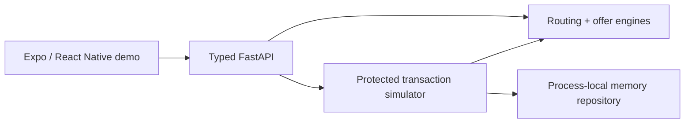

# Relay 0.6 Demo — presenter guide

Relay demonstrates a decision/routing layer, not a payment product. All cards,
pricing, providers and financial activity are simulated. No money moves. There
is no live issuer, bank, network, processor, bureau, KYC or payment integration.
This original Relay design is not copied from CheQ or another product.

## Thirty-second introduction

“Relay makes a credit portfolio understandable, checks which simulated routes
are eligible, compares their estimated costs, and explains the lowest-cost
eligible recommendation. This prototype also demonstrates a fictional offer
marketplace and a backend-protected transaction lifecycle. Nothing charges a
card or moves money.”

## Run locally

From the checkout root, with Python 3.12+ and Node 22+ installed:

```bash
python -m venv backend/.venv
backend/.venv/bin/python -m pip install -r backend/requirements.txt
cd mobile
npm ci
EXPO_OFFLINE=1 EXPO_NO_TELEMETRY=1 npm run build:web
cd ../backend
.venv/bin/uvicorn app.main:app --host 0.0.0.0 --port 8000 --workers 1
```

Open `http://127.0.0.1:8000` on your machine. The same process serves the API and
exported Expo web app. Rebuild frontend changes before restarting the API.
Windows PowerShell equivalents are in README. On read-only-home cloud machines,
use `npm_config_cache=/tmp/relay-npm-cache` and pip's
`--cache-dir /tmp/relay-pip-cache`; these paths contain caches, not credentials.

Production Docker alternative, from the checkout root:

```bash
docker build -t relay-cheq-demo .
docker run --rm --name relay-cheq-demo -p 8000:8000 -e PORT=8000 relay-cheq-demo
```

If a corporate/cloud HTTPS proxy needs a trusted custom CA, the build accepts
an optional BuildKit CA bundle secret. For the validated Linux environment:

```bash
docker build --secret id=build_ca,src=/etc/ssl/certs/ca-certificates.crt -t relay-cheq-demo .
```

The trust bundle is mounted only during npm/pip installation, never copied to
the image. Verification remains enabled. Normal public-network builds require
no secret. Use Docker with BuildKit support. The runtime health check verifies
`/api/health`, including a custom nonempty `PORT`.

Health checks (in another terminal while running):

```bash
curl --fail http://127.0.0.1:8000/api/health
curl --fail http://127.0.0.1:8000/ >/dev/null
docker inspect --format '{{.State.Health.Status}}' relay-cheq-demo
```

## Demo access

- Email: **demo@relay.app**
- Password: **Relay@123**
- **Autofill demo credentials** fills these public demo values.

This is a local UI gate, not real authentication or backend access control.
No external auth provider, real tokens, account connection, or database exists.
Only a boolean demo-access flag is saved in browser-tab session storage; the
password is not persisted. Logout clears that flag and unmounts the product UI.
A browser reload keeps access in the same tab when session storage is available.
If storage is disabled, sign in again after reloading. Native access is in
memory only. Never enter personal financial credentials into this demo.

## Exact presentation sequence

### Demo 1 — eligible route and simulated execution

1. Launch Relay. The short brand intro says **Intelligent credit routing.**
2. Autofill and **Sign In**. Point out **Demo environment** and the no-account copy.
3. Show Home: total outstanding **₹69,550**, available **₹3,80,450**, utilization
   **15.46%**, and the next due mock card. These values come from the API. The
   statement dates are fixed illustrative records, not a live payment schedule.
4. Optionally open Cards and a Card Details record. Explain masked demo data.
5. Press **Optimize My Credit**. Use compact FROM/TO selectors; defaults are
   **ICICI Amazon Pay → HDFC Regalia**, amount **₹10,000**.
6. Press **Find Best Route**. The app requests `/api/routes/quote`.
7. Show the obvious Card-to-Card recommendation: **₹10,125** (₹125 fee, ₹0
   estimated interest), and all four route options.
8. Expand **Why this recommendation?**. Explain that the displayed text is
   returned by the backend, never invented by the frontend.
9. Open **View Eligible Card-to-Card Route details**. Show the passed rules,
   assumptions, warnings, and explicit production-support disclaimer. The six
   summary checks and full route-specific checks remain inspectable.
10. Press **Select Eligible Card-to-Card Route**. Review confirmation, FROM/TO,
    amount and cost breakdown. Read **No money will move** and the recheck copy.
11. Press **Simulate Route**. Creation rechecks current rules and server prices.
12. Press **Auto Demo**. Watch backend-confirmed steps:
    `CREATED → ELIGIBILITY_CHECK → ELIGIBLE → AUTHORIZED → PROCESSING → SIMULATED_SETTLED`.
    Each step calls the existing advance endpoint with its expected state.
13. Show **SIMULATED SETTLED / Simulation completed / No money moved**.
14. Press **View in Activity**, under **Your demo simulations**, and reopen that
    transaction's full timeline. Quote events and **Example activity** have
    separate headings, so examples are not confused with created transactions.

### Demo 2 — blocked pair and fallback

15. Return to Optimize. Expand FROM and select **Axis ACE**; leave HDFC and ₹10,000.
16. Press **Find Best Route**. Explain **Card-to-Card is unavailable for this
    simulated card pair** and **3 alternative routes available**.
17. Inspect `SOURCE_PROGRAM_DISABLED` and `PAIR_NOT_SUPPORTED`. They are stable
    backend reasons, not universal statements about a real issuer.
18. Show the lowest-cost eligible fallback: **Refinancing, ₹10,320**.
19. Open fallback Route Details. The blocked route has no selection action.

### Demo 3 — fictional Marketplace

20. Press **Browse Balance Transfer offers**, or go to Optimize → **Open Marketplace**.
21. Keep the HDFC-like destination and enter **₹20,000**. Press **Compare fictional offers**.
22. Show **SIMULATED OFFER** labels, eligible Cedar (**₹20,300**) and Birch
    (**₹20,600**) ranked by backend total repayment, never partner commission.
23. Expand **Why this offer?** and open **Offer Details**. Explain fees, flat
    fictional interest, tenure, monthly/final estimates, and the stated baseline.
24. Cedar shows **₹400 illustrative savings** versus the **₹20,700 single-cycle
    carried-balance baseline**. This is not a tenure-matched loan comparison or
    a promise of savings. Negative savings remain visible for costlier options.
25. Select Cedar and enter the same simulation flow. The selected offer ID,
    tenure, backend price and complete quote snapshot are stored and rechecked.
26. Switch to Refinancing at ₹10,000: Quartz (6 months / ₹10,400 total), Lumen
    (12 months / ₹10,475 total). Lower monthly cost can mean more repayment.
27. Show ineligible Moss and inactive Paper: they cannot be selected. No actual
    lending offer, application, KYC or bureau pull exists.

## Presenter controls and recovery

- **CheQ Demo**, on Home or Profile, resets only the UI to ICICI → HDFC / ₹10,000
  in Optimize. It does not alter financial rules, fabricate a recommendation,
  delete backend records, or force eligibility.
- **Manual mode** pauses future automatic steps; **Advance simulation** executes
  exactly one backend step. A request already accepted by the server may finish.
- **Cancel simulation** is available only where returned by backend allowed
  actions (before processing). Processing/final states cannot be cancelled.
- For failure, choose **Fail at processing demo** in confirmation's controlled
  demo options, then start and auto/manual advance. The backend deterministically
  ends in `FAILED` with `DEMO_PROCESSING_FAILURE`. No random failures exist.
- Auto Demo stops on terminal states/errors, navigation/unmount, or app/tab
  backgrounding. It does not fake a state locally, skip states, or retry a
  failing transition in a loop. Resume deliberately with Auto Demo or manual.
- A stale-state error asks you to **Refresh timeline**. **Show technical details**
  exposes stable codes without making the primary message technical.
- For a network outage, restart/reconnect the API and use Retry/Refresh. A
  rejected creation stays on confirmation; request a fresh quote or another route.
- Logout returns to Login. It does not delete shared backend simulation history.

## Questions a technical lead may ask

| Question | Concise answer |
| --- | --- |
| Is Card-to-Card actually live? | No. It is a prototype eligibility simulation, not evidence of issuer/network/provider support. |
| Which payment rail is used? | None. Only local API calls and simulated state transitions exist. No rail or integration has been validated. |
| Why can't I directly pay one card using another? | Funding-source, issuer, network and regulated-provider rules constrain bill repayment. There is no universally supported direct credit-card-to-card route; a real route needs explicit permitted partner capabilities. |
| What does Relay own versus a bank/processor? | This prototype owns comparison, rule orchestration, explanations, and local simulation. A real regulated partner would own its permitted financial execution and authoritative outcomes under agreed responsibilities. |
| Where does eligibility logic live? | Backend `routing.py` and `offers.py`; transaction creation and eligibility progression re-evaluate those services. React only renders typed results. |
| Can frontend manipulate costs? | Financial prices are recomputed on the server. Forged client costs/eligibility/status fields are rejected. The public demo login is not a security boundary; production auth is not implemented. |
| How are recommendations ranked? | Lowest estimated eligible route cost; offer ranking uses total repayment, processing time, fee, then stable ID. No payout/commission signal exists. All estimates/assumptions are fictional and disclosed. |
| How would you integrate a real provider? | Add a validated provider adapter behind the existing routing/provider boundary and replace memory storage with durable transactional storage, without moving pricing/rules into the UI. Only use approved partner capabilities and contracts. |
| What compliance work would be needed? | Establish the actual business model/jurisdiction with legal, regulated partners and security teams; validate issuer/network permissions, applicable payment/lending rules, KYC/AML allocation, consent/privacy, data security, disclosures and audit duties. The prototype is not a compliance approval. |
| What is the long-term architecture? | An authenticated API, versioned rules/provider adapters, durable transaction repository, idempotent execution and verified partner event handling, audit/risk controls and observability. These production capabilities are future work, not live in this demo. |

Actual current architecture:



## Verification and screenshots

From the checkout root:

```bash
(cd backend && .venv/bin/python -m unittest discover -s tests -v)
(cd mobile && npm run typecheck)
(cd mobile && EXPO_OFFLINE=1 EXPO_NO_TELEMETRY=1 npm run build:web)
(cd mobile && CHROMIUM_PATH=/usr/bin/chromium npm run test:e2e)
```

Use Playwright's installed Chromium if system Chromium is absent. To run the
same browser suite against a container on port 8001:

```bash
cd mobile
RELAY_TEST_BASE_URL=http://127.0.0.1:8001 CHROMIUM_PATH=/usr/bin/chromium npm run test:e2e
```

The preserved 23 scenarios retain their financial/protection assertions. Changes
only add login setup, expand compact selectors, use new visible copy, disclose
technical errors, and scope Activity assertions to the created transaction ID.
Thirteen new checks cover demo access, wrong login, reload/logout, local-time
greetings, reset, backend-confirmed auto success/failure, stop/recovery and three
viewports. Baseline and final test evidence is summarized in the PR.

Regenerate the 13 real running-app screenshots (no mocked financial responses):

```bash
CHROMIUM_PATH=/usr/bin/chromium node mobile/scripts/capture-demo.cjs
# Optional: RELAY_DEMO_BASE_URL=http://127.0.0.1:8001 before the command
```

| Screen | Screenshot |
| --- | --- |
| Login | [Login](previews/cheq-demo/01-login.png) |
| Home | [Home](previews/cheq-demo/02-home.png) |
| Optimize | [Optimize](previews/cheq-demo/03-optimize.png) |
| Route Analysis | [Analysis](previews/cheq-demo/04-route-analysis.png) |
| Route Details | [Route Details](previews/cheq-demo/05-route-details.png) |
| Marketplace | [Marketplace](previews/cheq-demo/06-marketplace.png) |
| Offer Details | [Offer Details](previews/cheq-demo/07-offer-details.png) |
| Confirmation | [Confirmation](previews/cheq-demo/08-confirmation.png) |
| Simulated Settled | [Settled](previews/cheq-demo/09-simulated-settled.png) |
| Activity | [Activity](previews/cheq-demo/10-activity.png) |
| Axis blocked | [Blocked pair](previews/cheq-demo/11-axis-blocked.png) |
| 430 × 932 | [Larger mobile](previews/cheq-demo/12-home-430.png) |
| Desktop | [Presentation frame](previews/cheq-demo/13-desktop-frame.png) |

## Known limitations

- Local, public demo credentials are not real authentication. Backend endpoints
  remain unauthenticated and contain only fictional records. Do not connect
  real financial data or treat this as a production financial service.
- Transactions are single-worker memory records; API restarts clear them.
  Card statement dates are fixed mock records. No balances or real funds move.
- Web rendering is checked at 390 × 844, 430 × 932 and desktop. Native Android/iOS
  simulator/device builds are not validated by these browser tests.
- The existing pinned Expo/toolchain dependency graph reports eight npm audit
  findings (five high, three moderate). Dependency versions were not changed or
  blindly auto-fixed; security review/upgrades remain separate production work.
- Network proxy CA support is optional build-time trust configuration. TLS and
  package integrity verification remain enabled. There is no public deployment
  or financial integration created by this branch.
