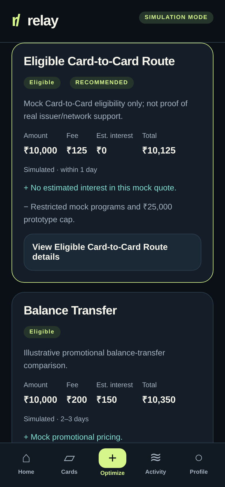
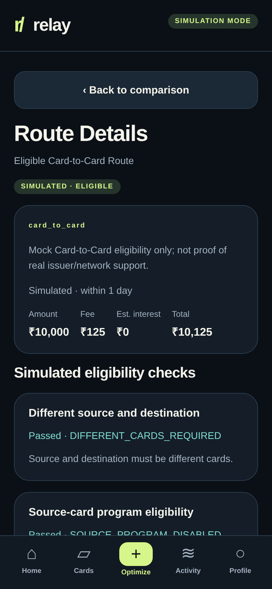

# Simulated routing API v1.0

`POST /api/routes/quote` is the canonical Phase 3 contract. Read-only mock
capabilities are exposed by `GET /api/routes/capabilities`. Neither endpoint
connects to banks, networks, lenders, or payment systems. OpenAPI schemas are
available at `/docs`; shared Pydantic models live in `app/routing_models.py`.

Example request (card IDs come from `/api/cards`, not issuer names):

```json
{"source_card_id":"icici_amazon","destination_card_id":"hdfc_regalia","amount":10000}
```

The response request summary is `source`, `destination`, and `amount`; `source`
and `destination` are mock card snapshots. `schema_version` is `1.0`.

| Field | Contract |
| --- | --- |
| `routes` | All four options in stable Card-to-Card, balance transfer, normal repayment, refinancing order |
| `routes[].id`, `route_type`, `display_name` | Stable route ID/type and presentation label |
| `eligible`, `eligibility_status` | Boolean and `eligible`/`ineligible` status |
| `checks` | Rule key, stable code, label, passed flag, backend explanation |
| `blocking_reasons` | Code/message for each failed rule; empty on eligible routes |
| `warnings`, `pros`, `cons`, `assumptions` | Backend-authored simulation caveats and trade-offs |
| `amount`, `estimated_fee`, `estimated_interest`, `estimated_total_cost` | INR numbers, not formatted currency strings |
| `processing_time_label` | Illustrative processing time, explicitly simulated |
| `recommendation_rank` | 1-based cost rank among eligible routes; null for blocked routes |
| `recommended_route_id`, `recommendation` | Winner ID and full quote; both null if no route qualifies |
| `recommendation_explanation` | Backend-generated rationale including Card-to-Card blocking codes when applicable |
| `simulated`, `disclaimer` | Explicit simulation flag and boundaries, on the response and every route |

Top-level `checks` preserves the six original Card-to-Card summary checks/order.
Route Details shows **all** relevant checks: eight for Card-to-Card, including
positive-amount and explicit pair-capability checks. Alternative routes have
their own rules, not a copy of Card-to-Card eligibility.

## Rules and errors

| Stable code | Meaning / scope |
| --- | --- |
| `DIFFERENT_CARDS_REQUIRED` | Same card selected; blocks every route |
| `SOURCE_PROGRAM_DISABLED` | Source mock Card-to-Card program disabled |
| `DESTINATION_DISABLED` | Destination cannot receive mock repayment; blocks every route |
| `INSUFFICIENT_SOURCE_LIMIT` | Card-to-Card exceeds source available credit |
| `EXCEEDS_OUTSTANDING` | Amount exceeds destination balance; blocks every route |
| `EXCEEDS_PROTOTYPE_LIMIT` | Card-to-Card exceeds ₹25,000 |
| `INVALID_AMOUNT` | Non-positive, non-finite, nonnumeric, sub-paise, or over ₹1,000,000,000 |
| `PAIR_NOT_SUPPORTED` | Pair absent from the mock capability matrix |
| `BALANCE_TRANSFER_LIMIT` | Balance transfer exceeds ₹60,000 |
| `REFINANCE_MINIMUM` | Refinancing below ₹5,000 |
| `CARD_NOT_FOUND` | Unknown mock card ID (HTTP 404) |
| `INVALID_REQUEST` | Missing or malformed request fields/body (HTTP 422) |

For well-formed known-card requests, rule failures return HTTP 200 with all
four quotes, blocking reasons, and possibly no recommendation. Zero/negative
or otherwise invalid amounts return HTTP 422. Error bodies have
`detail: {code, message}`. Request validation never echoes raw input values.

Balance transfer, normal repayment, and refinancing assume alternative
funding, so source-card available credit/program/pair constraints do not apply
to them. Their assumptions explain this explicitly. They still require distinct
cards, a receiving destination, and an amount within destination outstanding.
Normal repayment illustrates carrying a balance, not interest-free full
repayment. No quote is an actual offer or proof of issuer/network support.

## Engine and provider boundary

`app/routing.py` owns mock capability configuration, stable checks, rate tables,
providers, cost rounding, ranking, and recommendation rationale. A lightweight
`RouteProvider` protocol returns a `RouteOption`; four configured mock providers
supply the current options. Ranking is deterministic by `(estimated_total_cost,
route_id)` among eligible routes only. No shared quote state is mutated.

Money uses decimal arithmetic with half-up rounding to paise per fee/interest
component. Total is principal + rounded fee + rounded interest. Tied costs use
the route ID as a documented stable tie-breaker; no financial preference is
claimed for ties. The API returns numbers; the UI only formats them.

The capability matrix is simulated test configuration derived from the mock
card program flags at startup. Changing a flag alone on a copied card does not
add a pair to the frozen matrix. No issuer support is inferred from this data.

## Compatibility

`/api/optimize` and `/api/transfers/eligibility` remain available. The legacy
adapter in `app/services.py` retains six-check ordering, field names, and the
original permissive fallback eligibility semantics for older clients/tests.
It projects shared provider quotes; it does not contain a second cost engine.
The new app uses `/api/routes/quote` and its stricter shared validation for
alternatives. New clients should use that endpoint. Paise rounding is now
consistent across provider calculations.

## Verified demos

- ICICI Amazon Pay (`icici_amazon`) → HDFC Regalia (`hdfc_regalia`), ₹10,000:
  Card-to-Card eligible, recommended total ₹10,125.
- Axis ACE (`axis_ace`) → HDFC, ₹10,000: blocked by
  `SOURCE_PROGRAM_DISABLED` and `PAIR_NOT_SUPPORTED`; three alternatives remain
  eligible, refinancing recommended at ₹10,320.
- Same-card: all options ineligible with `DIFFERENT_CARDS_REQUIRED`, no winner.




