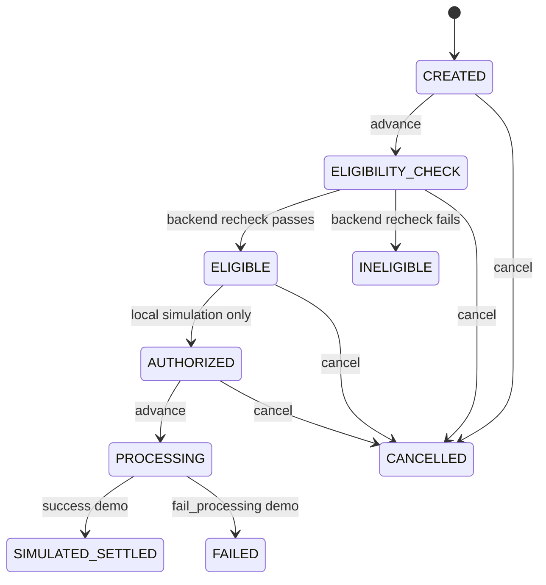

# Phase 4: local transaction simulator

Every transaction is a **local simulation**. No money moves; no bank, network,
issuer, wallet, or lender is connected. Card balances are never mutated. No
payment credentials are collected. This is not a production payment service.

## Architecture

- `backend/app/transaction_models.py`: typed creation/transition/cancel requests,
  statuses, immutable-by-snapshot quote data, timestamped events, transaction and
  response models. `simulated` is always true. Client quote/cost/eligibility or
  arbitrary extra fields are rejected, not used.
- `backend/app/transactions.py`: orchestration, the success graph, cancellation
  rules, deterministic failure, eligibility recheck, stable domain errors, and
  allowed actions. No business/state-machine policy exists in the frontend.
- `backend/app/transaction_repository.py`: replaceable repository protocol and
  an in-memory implementation. Reads/writes use deep copies. State mutations
  execute atomically under a process-local lock; a rejected mutation does not
  alter history or state.
- `backend/app/transactions_api.py`: typed FastAPI adapter for the five endpoints.
  It owns one service/repository per API process, with no external integrations.
- `mobile/src/transactionTypes.ts`, `api.ts`: reusable typed transaction contracts
  and API methods. `TransactionScreens.tsx` composes shared primitives for
  confirmation, timeline, and server-backed Activity. `RouteCosts.tsx` shares the
  existing quote cost display without recalculating costs.

Creation calls the **Phase 3** `routing.quote_routes` engine with server-resolved
cards, amount and selected route ID. It rejects blocked routes with
`ROUTE_INELIGIBLE` before saving anything. The selected backend quote, mock card
snapshots, authoritative fees/interest/total and simulation outcome are stored.
An earlier quote response is never proof of current eligibility.

The `ELIGIBILITY_CHECK` advance re-runs the engine again. If the mock rules have
changed, it records `INELIGIBLE` with stable reasons and a separate latest-check
snapshot. The creation quote is retained for understandable history.

## Central state machine



`INELIGIBLE`, `FAILED`, `CANCELLED`, and `SIMULATED_SETTLED` are terminal.
Processing cannot be cancelled. Every mutation must include `expected_status`;
a stale request receives HTTP 409 without an extra event. Optional advance
`target_status` checks the next nominal edge and cannot force an arbitrary
transition or override a backend eligibility result. No automatic timers or
fake provider callbacks advance a transaction.

The response includes `allowed_actions` and `next_status` so clients do not
reimplement transition rules. At `ELIGIBILITY_CHECK`, the nominal next step can
instead become `INELIGIBLE` if the backend recheck fails.

## API

Use the normal backend startup instructions in README. All endpoints are local
simulations and the OpenAPI contracts are available at `/docs`.

| Method/path | Behavior |
| --- | --- |
| `POST /api/transactions` | Re-quote, validate selection and create `CREATED`; HTTP 201 |
| `GET /api/transactions` | List snapshots newest-first |
| `GET /api/transactions/{id}` | Get transaction, full history and allowed actions |
| `POST /api/transactions/{id}/advance` | Advance exactly one allowed simulation step |
| `POST /api/transactions/{id}/cancel` | Cancel from an allowed pre-processing state |

Creation example:

```json
{
  "source_card_id": "icici_amazon",
  "destination_card_id": "hdfc_regalia",
  "amount": 10000,
  "route_id": "card_to_card",
  "demo_outcome": "success"
}
```

`demo_outcome` defaults to `success`. Use `fail_processing` to deterministically
fail on the advance from `PROCESSING`, with `DEMO_PROCESSING_FAILURE`. It has
no effect on eligibility and never bypasses the routing engine.

Advance one step:

```json
{"expected_status":"CREATED"}
```

To verify skipping is rejected, send
`{"expected_status":"CREATED","target_status":"SIMULATED_SETTLED"}`.
Cancel with `{"expected_status":"CREATED"}` at the cancel endpoint.
The response includes UUID, source/destination IDs and card snapshots, amount,
route ID/type, quoted fee/interest/total, creation quote snapshot, optional latest
eligibility snapshot, current status, timestamped ordered history, failure
code/reason, creation/update times, simulation flag/disclaimer, and allowed actions.

Errors have `detail: {code, message, ...}`:

| Code | HTTP | Meaning |
| --- | --- | --- |
| `ROUTE_INELIGIBLE` | 409 | Backend quote blocked creation; includes blocking reasons, no record saved |
| `INVALID_TRANSITION` | 409 | Requested skip or advance from a terminal state |
| `STALE_TRANSACTION_STATE` | 409 | Expected state no longer matches; refresh first |
| `CANCELLATION_NOT_ALLOWED` | 409 | Current state is processing or terminal |
| `TRANSACTION_NOT_FOUND` | 404 | Unknown transaction or server-memory reset |
| `CARD_NOT_FOUND` | 404 | Unknown mock source/destination |
| `INVALID_AMOUNT` | 422 | Invalid/zero/negative/sub-paise/nonfinite amount |
| `INVALID_REQUEST` | 422 | Missing, malformed, or extra fields / invalid route or state enum |

Terminal event codes are `ROUTE_BECAME_INELIGIBLE` and
`DEMO_PROCESSING_FAILURE` for the corresponding paths. They are history events,
not successful HTTP requests to external services.

## Mobile demo

1. Home → Optimize → ICICI Amazon Pay → HDFC Regalia → ₹10,000 → run quote.
2. Choose **Select Eligible Card-to-Card Route**. Review source/destination,
   amount, fee ₹125, interest ₹0, total ₹10,125 and simulation warnings.
3. Leave **Success demo** selected and press **Simulate Route**. The backend
   rechecks before creating the record. No client cost or eligibility is sent.
4. Press **Advance simulation** five times, one local step each, to reach
   `SIMULATED_SETTLED`. Read the timestamped events; no money moved.
5. Press **View in Activity**, then **Open simulation …** to reopen its timeline.
   Browser reloads retain server-memory history; quote events are session-local.
6. Create another simulation and cancel before processing. Its Activity status
   and timeline show `CANCELLED`.
7. Choose **Fail at processing demo** on confirmation. Advance to `PROCESSING`,
   then once more to `FAILED`; the reason and retry instructions are explicit.
8. Axis → HDFC ₹10,000 blocks Card-to-Card selection/API creation. Refinancing
   remains selectable and creates an authoritative ₹10,320 snapshot.

Every confirmation/timeline shows **Simulation Mode**, **No money moved**, and
**No bank/network/issuer integration**. The UI displays only server-owned actions;
terminal transactions have no advance/cancel control. Refresh handles stale
state errors. Creation disables its controls/tabs to avoid duplicate clicks or
unexpected navigation. A failed recheck remains on confirmation with an error.

## Persistence and limits

Use **one API worker**. The repository is in memory, process-local, unauthenticated
prototype storage: restarting the API (including reload) clears history, and
multiple workers do not share it. A database-backed repository can later replace
this adapter with transactional compare-and-update semantics. There is no
production database, callback infrastructure, balance mutation, or payment code.
Native Android/iOS rendering remains untested; browser tests use 390 × 844.

## Validation

- 46 Python tests: 27 unchanged Phase 1–3 cases plus 19 transaction tests,
  covering all valid success edges, skip rejection, every terminal/cancel rule,
  stale and concurrent updates, quote rechecks, client-field rejection, snapshots,
  unknown IDs, deterministic failure, listing/details, and unchanged balances.
- 17 Playwright tests: 11 unchanged Phase 1–3 cases plus six simulation tests
  covering settlement/Activity/reload, cancellation, deterministic failure,
  direct API integrity, fallback selection, and rejected-creation recovery.
- TypeScript, Expo web export, and Git whitespace checks.
